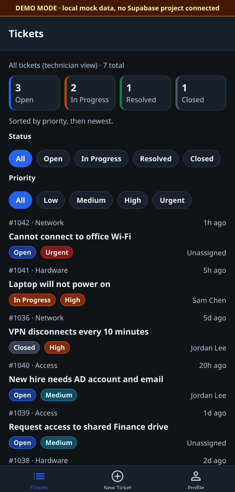
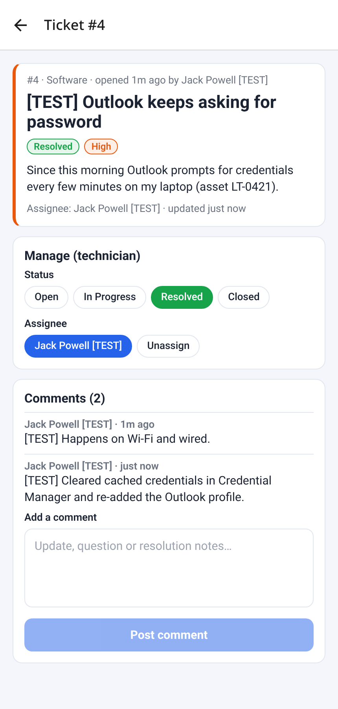

# IT Help Desk Ticket Tracker

Employees submit IT tickets. Technicians triage, assign, and resolve them. Admins can do both and change roles. This is that workflow as a cross-platform app (iOS, Android, and web): React Native, Expo Router, and TypeScript on Supabase, with access control enforced in Postgres. When no Supabase project is configured, the same screens run on local mock data, which is how the public site stays usable while a hosted database is paused.

**[Try the live demo](https://mercury101999.github.io/helpdesk-ticket-tracker/).** No sign-up. On the sign-in screen, continue as Requester, Technician, or Admin.

[](https://github.com/Mercury101999/helpdesk-ticket-tracker/actions/workflows/ci.yml) [](https://github.com/Mercury101999/helpdesk-ticket-tracker/actions/workflows/deploy-pages.yml) [](LICENSE)

<p>
  
  
  
  
</p>

<p>
  
  
</p>

The dark queue is the same demo data with Appearance set to Dark. The second shot is the app on a hosted Supabase project (no demo banner): a test ticket assigned, commented, and resolved. That project is paused, so the shot was not retaken for 1.1.0. The screen is the same; spacing, contrast, and the section title have since been tightened.

## Features

- **Ticket queue**: status counts you can tap to filter, status and priority chips, color-coded badges, sorted by priority then newest.
- **Ticket detail**: description, requester, assignee, comment thread, and technician-only controls for status and assignment, including "Assign to me".
- **New ticket form**: category (hardware, software, network, access, other), priority (low through urgent), and client-side validation that matches the database `CHECK` constraints. Comments use the same 1–2,000 character limit.
- **Auth**: email and password sign-in and sign-up through Supabase Auth. New users get a `requester` profile automatically.
- **Roles**: `requester`, `technician`, and `admin`, each with different permissions (see [Row Level Security](#row-level-security)).
- **Demo mode**: no keys means mock data, a role picker on the sign-in screen, and the same visibility rules applied locally.
- **Appearance**: light, dark, or follow the device. The choice is saved on the device. Keyboard focus is visible on web.

## Tech stack

| Layer | Tech |
| --- | --- |
| App | React Native 0.88, Expo SDK 58, Expo Router (file-based routing, tabs + stack, `Stack.Protected` auth gate) |
| Language | TypeScript (strict) |
| Backend | Supabase: Postgres, Auth, Row Level Security, triggers |
| Appearance | System, light, and dark. `expo-system-ui` so Android honors `userInterfaceStyle` |
| Web | react-native-web, static SPA export (`expo export -p web`), GitHub Pages |
| Quality | Jest + React Native Testing Library, ESLint (`eslint-config-expo`), `tsc --noEmit`, PGlite in-memory Postgres RLS smoke test, GitHub Actions |

## Architecture

```
app/
  _layout.tsx           Root: data + theme providers, demo banner, auth gate
  sign-in.tsx           Sign in (+ demo role picker)
  sign-up.tsx           Create account
  (tabs)/index.tsx      Ticket list + filters
  (tabs)/new.tsx        New ticket form
  (tabs)/profile.tsx    Profile, role, stats, appearance, sign out
  ticket/[id].tsx       Ticket detail, status/assignee, comments
components/
  ui.tsx                Badges, chips, buttons, fields, empty state
  ThemeProvider.tsx     Light/dark palettes and the navigation theme
lib/
  DataProvider.tsx      Single data layer: Supabase OR mock data behind one API
  supabase.ts           Client from EXPO_PUBLIC_SUPABASE_* env vars, DEMO_MODE flag
  mockData.ts           Demo users, tickets, comments
  tickets.ts            Pure ticket logic: sort, filter, RLS mirror, status transitions
  theme.ts              Palettes and status/priority colors (contrast-checked)
  types.ts, validation.ts, format.ts, errors.ts
supabase/
  migrations/…_init_helpdesk.sql                 Schema, triggers, RLS policies
  migrations/…_security_performance_hardening.sql  Advisor fixes
  seed.sql                                       Demo users for `supabase db reset` only
scripts/verify-db.mjs   Runs the migrations + seed and checks RLS in in-memory Postgres
__tests__/              Jest: validation, ticket logic, theme contrast, data provider, screens
```

Screens never talk to Supabase directly. They call `useData()` (`createTicket`, `updateTicket`, `addComment`, …). That keeps the UI backend-agnostic and is what makes demo mode possible.

### Data model

```
auth.users 1─1 profiles (id, full_name, email, department, role: requester|technician|admin)
profiles   1─* tickets  (requester_id)        tickets.assignee_id ─* profiles
tickets    1─* ticket_comments (ticket_id, author_id, body)

tickets: id, title, description,
         category  hardware|software|network|access|other
         priority  low|medium|high|urgent
         status    open|in_progress|resolved|closed
         requester_id, assignee_id, created_at, updated_at, resolved_at
```

Triggers keep `updated_at` and `resolved_at` current and create a `profiles` row for every new auth user.

## Row Level Security

RLS is enabled on every table, so permissions hold even if someone calls the API directly with the public anon key.

| Who | profiles | tickets | ticket_comments |
| --- | --- | --- | --- |
| Requester | read/update own (not role) | read own, create for self, edit own title/description | read/add on own tickets |
| Technician | read all | read all, update status/priority/assignee | read/add on all tickets |
| Admin | read all, change roles | everything technicians can, plus delete | plus delete any comment |

Implementation notes:

- `private.is_staff()` and `private.is_admin()` are `SECURITY DEFINER` helpers so policies can check the caller's role without recursive RLS on `profiles`. They live in a non-exposed `private` schema, so the REST API cannot call them.
- Policies wrap `auth.uid()` and the helpers in `(select …)` so Postgres evaluates them once per query instead of once per row, and each table has a single UPDATE policy.
- Trigger functions pin `search_path` and are not executable by the `anon` or `authenticated` API roles. Supabase's security advisor reports no findings for this schema.
- Column-level rules RLS cannot express (requesters may not change status, assignee, or priority; non-admins may not change roles) are enforced by `BEFORE UPDATE` triggers.
- `npm run verify:db` loads the migrations and seed into an in-memory Postgres and asserts that a requester sees only their own tickets, cannot change status, cannot self-promote, and cannot create tickets for someone else, and that a technician can resolve and assign.

## Getting started

```bash
git clone https://github.com/Mercury101999/helpdesk-ticket-tracker.git
cd helpdesk-ticket-tracker
npm install
npx expo start --web        # or press i / a for iOS / Android
```

With no `.env`, the app opens in **demo mode**. Pick Requester, Technician, or Admin on the sign-in screen. Profile → Appearance switches light and dark.

### Connect a real Supabase project

1. Create a project at [supabase.com](https://supabase.com).
2. Apply **both** files in `supabase/migrations/` in order (SQL editor, or `supabase link` + `supabase db push`). `seed.sql` writes demo users straight into `auth.users`, so use it **only for a local stack** (`supabase start && supabase db reset`, password `Password123!`), never on a hosted project.
3. `cp .env.example .env` and fill in `EXPO_PUBLIC_SUPABASE_URL` and `EXPO_PUBLIC_SUPABASE_ANON_KEY` (Project Settings → API Keys). The **publishable** key (`sb_publishable_…`) is recommended; the legacy `anon` JWT also works. Never put the `service_role` or secret key in the app.
4. Auth → Sign In / Providers → Email: either keep **Confirm email** on and configure custom SMTP (Supabase's built-in mailer only delivers to your team's addresses), or turn it off for a demo project so new sign-ups can log in immediately.
5. Restart `npx expo start`. The demo banner disappears and data comes from Postgres.
6. Promote a user (SQL editor): `update profiles set role = 'technician' where lower(email) = lower('…');` (Auth stores emails in lowercase.)

### Scripts

| Command | What it does |
| --- | --- |
| `npm run web` | Dev server for web |
| `npm run typecheck` | `tsc --noEmit` |
| `npm run lint` | ESLint |
| `npm test` | Jest unit and screen tests |
| `npm run export:web` | Production web build to `dist/` |
| `npm run verify:db` | Migration + RLS smoke test (in-memory Postgres) |

## Testing and CI

- **Unit tests** cover form and comment validation, ticket sorting and filtering, the client-side RLS mirror, status transitions (`resolved_at` handling), relative timestamps, and contrast of the light and dark palettes.
- **Data-provider tests** cover demo mode: create, assign, resolve, comment, sign-in by demo email, rejection of an unknown email, and sign-out.
- **Screen tests** (React Native Testing Library) render sign-in, the ticket list, profile, the new-ticket form, and ticket detail: role-based visibility, status filtering from the summary and the chips, validation errors, and a successful submit.
- **CI** (GitHub Actions, every push and pull request): `npm ci`, typecheck, lint, Jest, the Supabase migration and RLS smoke test, web export, and iOS and Android bundle exports.

## What I learned

This is the small system a help desk actually runs on: a shared queue, a status workflow, and permissions that still hold if someone calls the API directly.

- **Support workflow.** Intake is categorized and prioritized. The queue sorts by urgency, and technicians move a ticket from open to in progress to resolved to closed, with an assignee and a comment thread. Requesters only see their own tickets.
- **Access control in the database.** Row Level Security, security-definer helpers in a private schema, and triggers for the rules a policy cannot express (no self-promotion, requesters cannot change status). An in-memory Postgres test runs the real migration and checks those rules.
- **A UI that still works with the backend switched off.** One data hook talks to either Supabase or local mock data. That is how the public demo keeps working when the hosted project is paused, and how I could test screens without a network.
- **Shipping it like a product.** Typed end to end, tested at the form, the queue, the screen, and the policies, linted in CI, and deployed as a static demo that fails the build if a project URL or API key lands in the bundle.

## Deployment

Every push to `main` builds the web app and publishes it to GitHub Pages (`.github/workflows/deploy-pages.yml`):

- Sets Expo Router's `experiments.baseUrl` to `/helpdesk-ticket-tracker` at build time, so local dev is unchanged.
- Copies `index.html` to `404.html` so deep links such as `/ticket/1041` load the single-page app.
- The public demo is built **without** Supabase env vars, so it always runs in demo mode with a visible banner. Visitors cannot create accounts or data in the real database, and the build step fails if a project URL or API key ends up in the bundle.

## Roadmap

- [x] Milestone 1: schema and RLS, auth, ticket list, detail, and create, comments, demo mode, web build
- [ ] Realtime queue updates (Supabase Realtime) and push notifications on assignment
- [ ] SLA timers by priority, and overdue highlighting
- [ ] Asset inventory (link tickets to devices and asset tags)
- [ ] Attachments (screenshots) via Supabase Storage
- [ ] Admin dashboard: tickets by category, mean time to resolve
- [x] Milestone 2: Jest and Testing Library, ESLint, GitHub Actions, verified iOS and Android bundle exports
- [x] Milestone 3: hosted Supabase project, advisor-driven security and performance hardening, live RLS verification, and an end-to-end sign-up through technician resolution against the real backend
- [x] Milestone 4: public web demo on GitHub Pages, deployed automatically from `main`
- [x] Milestone 5: contrast, dark mode, keyboard focus, and queue empty states for the public demo
- [ ] EAS preview build for iOS and Android
- [ ] Optional live-backend mode on the public site (publishable key via Actions variables, sign-up rate limits, CAPTCHA)

## License

[MIT](LICENSE) © 2026 Jack Powell
