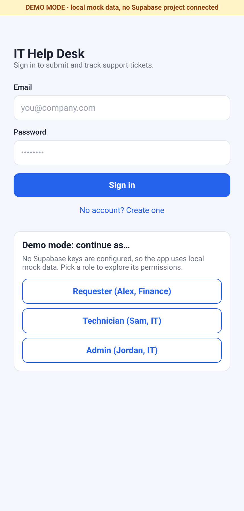
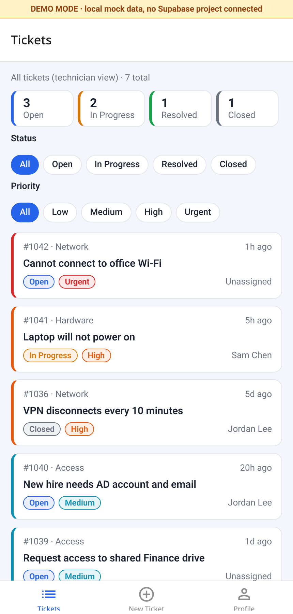
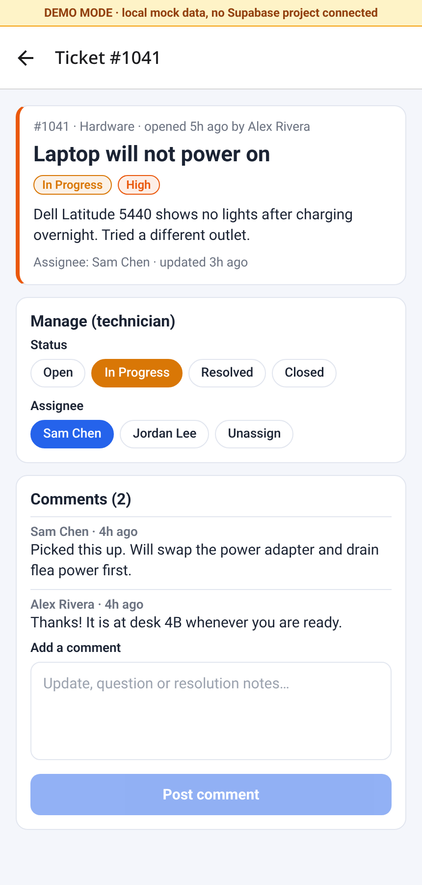
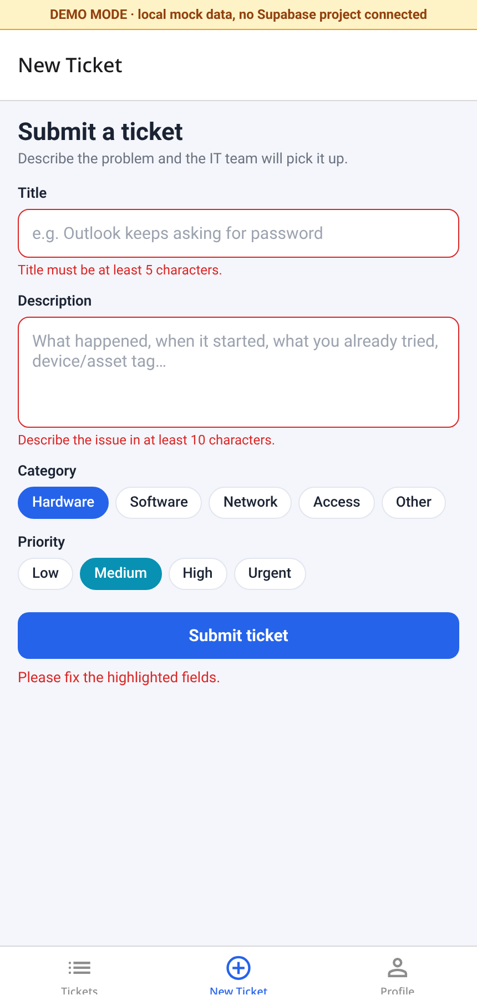

# IT Help Desk Ticket Tracker

A cross-platform (iOS / Android / web) help desk app where employees submit IT support tickets and technicians triage, assign and resolve them. Built with **React Native + Expo Router + TypeScript** on a **Supabase** (Postgres, Auth, Row Level Security) backend.

> **Runs without a backend.** If no Supabase keys are configured, the app starts in a clearly labeled **Demo Mode** with local mock data, so you can try every screen in seconds.

<p>
  
  
  
  
</p>

## Why

Help desks live and die by their ticket queue. This project models a real one end to end: intake (categorized, prioritized tickets), triage (status workflow, assignment), communication (comment threads) and **access control enforced in the database**, not just the UI.

## Features

- **Ticket queue**: status summary counters, filter chips for status and priority, color-coded badges, sorted by priority then age.
- **Ticket detail**: full description, requester/assignee, comment thread, and technician-only controls to change status and assign (including "Assign to me").
- **New ticket form**: category (hardware / software / network / access / other), priority (low → urgent) and client-side validation that mirrors the database `CHECK` constraints.
- **Auth**: email + password sign in / sign up via Supabase Auth; new users get a `requester` profile automatically.
- **Roles**: `requester`, `technician`, `admin`, each with different permissions (see [RLS](#row-level-security)).
- **Demo Mode**: no keys → mock data, a role picker on the sign-in screen, and RLS-like filtering emulated locally.

## Tech stack

| Layer | Tech |
| --- | --- |
| App | React Native 0.88, Expo SDK 58, Expo Router (file-based routing, tabs + stack, `Stack.Protected` auth gate) |
| Language | TypeScript (strict) |
| Backend | Supabase: Postgres, Auth, Row Level Security, triggers |
| Web | react-native-web, static SPA export (`expo export -p web`) |
| Tooling | `tsc --noEmit`, PGlite (in-memory Postgres) RLS smoke test, Playwright for screenshots |

## Architecture

```
app/
  _layout.tsx           Root: DataProvider, demo banner, auth gate (Stack.Protected)
  sign-in.tsx           Sign in (+ demo role picker)
  sign-up.tsx           Create account
  (tabs)/index.tsx      Ticket list + filters
  (tabs)/new.tsx        New ticket form
  (tabs)/profile.tsx    Profile, role, stats, sign out
  ticket/[id].tsx       Ticket detail, status/assignee, comments
components/ui.tsx       Badges, chips, buttons, fields, theme colors
lib/
  DataProvider.tsx      Single data layer: Supabase OR mock data behind one API
  supabase.ts           Client from EXPO_PUBLIC_SUPABASE_* env vars, DEMO_MODE flag
  mockData.ts           Demo users, tickets, comments
  types.ts, validation.ts, format.ts
supabase/
  migrations/…_init_helpdesk.sql   Schema, triggers, RLS policies
  seed.sql                          Demo users/tickets for `supabase db reset`
scripts/verify-db.mjs   Runs the migration + seed and checks RLS in in-memory Postgres
```

Screens never talk to Supabase directly; they call `useData()` (`createTicket`, `updateTicket`, `addComment`, …). That keeps UI code backend-agnostic and is what makes Demo Mode possible.

### Data model

```
auth.users 1─1 profiles (id, full_name, email, department, role: requester|technician|admin)
profiles   1─* tickets  (requester_id)        tickets.assignee_id ─* profiles
tickets    1─* ticket_comments (ticket_id, author_id, body)

tickets: id, title, description,
         category  hardware|software|network|access|other
         priority  low|medium|high|urgent
         status    open|in_progress|resolved|closed
         requester_id, assignee_id, created_at, updated_at, resolved_at
```

Triggers keep `updated_at` / `resolved_at` current and create a `profiles` row for every new auth user.

## Row Level Security

RLS is enabled on every table, so permissions hold even if someone calls the API directly with the public anon key.

| Who | profiles | tickets | ticket_comments |
| --- | --- | --- | --- |
| Requester | read/update own (not role) | read own, create for self, edit own title/description | read/add on own tickets |
| Technician | read all | read all, update status/priority/assignee | read/add on all tickets |
| Admin | read all, change roles | everything technicians can + delete | + delete any comment |

Implementation notes:
- `is_staff()` / `is_admin()` are `SECURITY DEFINER` helpers so policies can check the caller's role without recursive RLS on `profiles`.
- Column-level rules RLS can't express (requesters may not change status/assignee/priority; non-admins may not change roles) are enforced by `BEFORE UPDATE` triggers.
- `npm run verify:db` loads the migration and seed into an in-memory Postgres and asserts that a requester sees only their own tickets, cannot change status, cannot self-promote and cannot create tickets for someone else, and that a technician can resolve and assign.

## Getting started

```bash
git clone https://github.com/Mercury101999/helpdesk-ticket-tracker.git
cd helpdesk-ticket-tracker
npm install
npx expo start --web        # or press i / a for iOS / Android
```

With no `.env`, the app opens in **Demo Mode**. Pick Requester, Technician or Admin on the sign-in screen.

### Connect a real Supabase project

1. Create a project at [supabase.com](https://supabase.com).
2. Run `supabase/migrations/*.sql` in the SQL editor (or `supabase link` + `supabase db push`). For local dev, `supabase start && supabase db reset` also applies `seed.sql` (demo users, password `Password123!`).
3. `cp .env.example .env` and fill in `EXPO_PUBLIC_SUPABASE_URL` and `EXPO_PUBLIC_SUPABASE_ANON_KEY` (Project Settings → API).
4. Restart `npx expo start`. The demo banner disappears and data comes from Postgres.
5. Promote a user: `update profiles set role = 'technician' where email = '…';`

### Scripts

| Command | What it does |
| --- | --- |
| `npm run web` | Dev server for web |
| `npm run typecheck` | `tsc --noEmit` |
| `npm run export:web` | Production web build to `dist/` |
| `npm run verify:db` | Migration + RLS smoke test (in-memory Postgres) |

## Roadmap

- [x] Milestone 1: schema + RLS, auth, ticket list/detail/create, comments, demo mode, web build
- [ ] Realtime queue updates (Supabase Realtime) and push notifications on assignment
- [ ] SLA timers by priority, overdue highlighting
- [ ] Asset inventory (link tickets to devices / asset tags)
- [ ] Attachments (screenshots) via Supabase Storage
- [ ] Admin dashboard: tickets by category, mean time to resolve
- [ ] Unit tests (Jest) and CI with GitHub Actions; deploy web build

## License

[MIT](LICENSE) © 2026 Jack Powell
